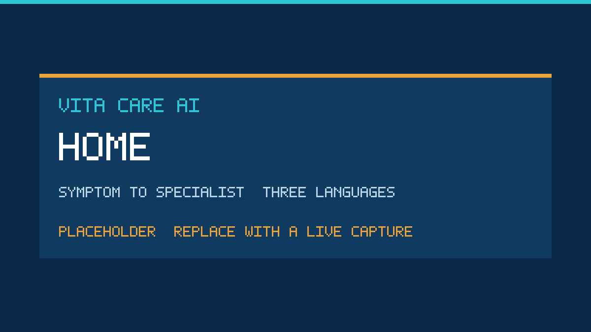
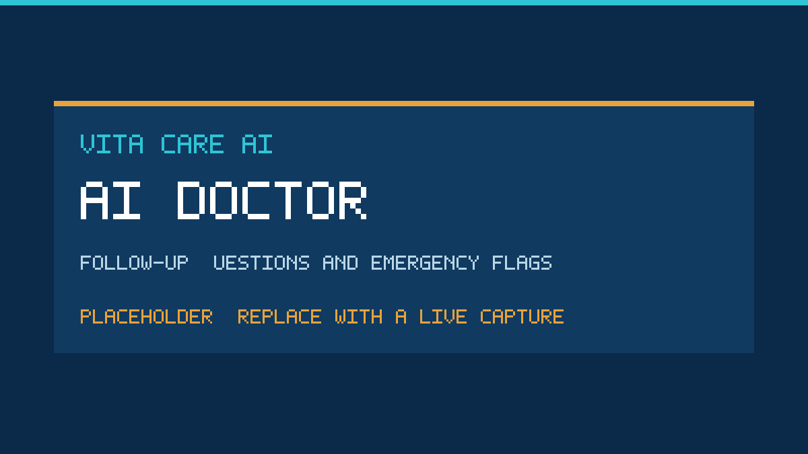
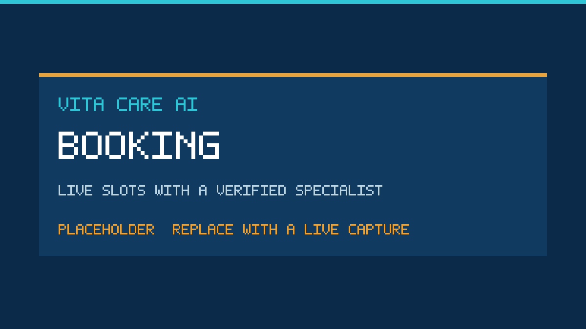
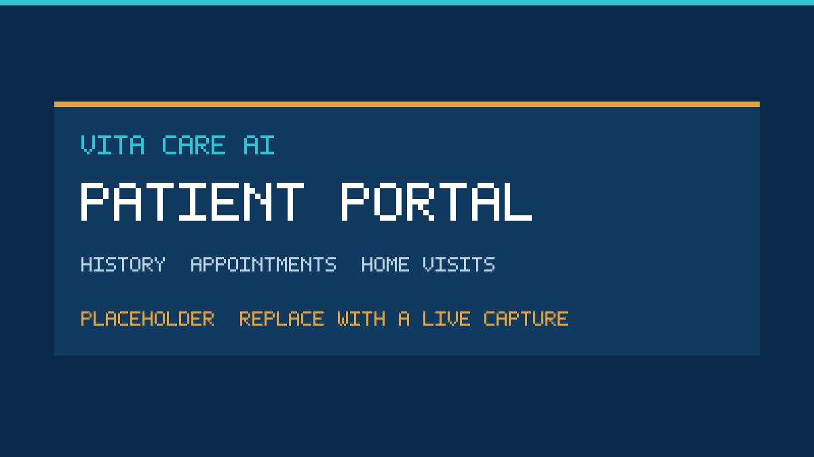
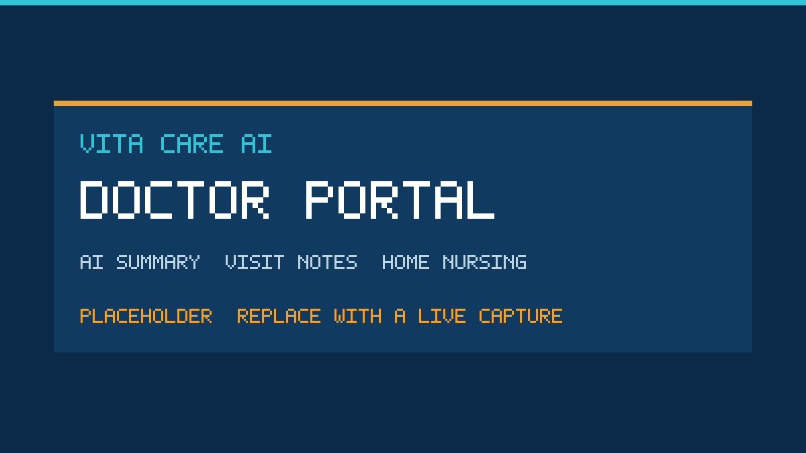
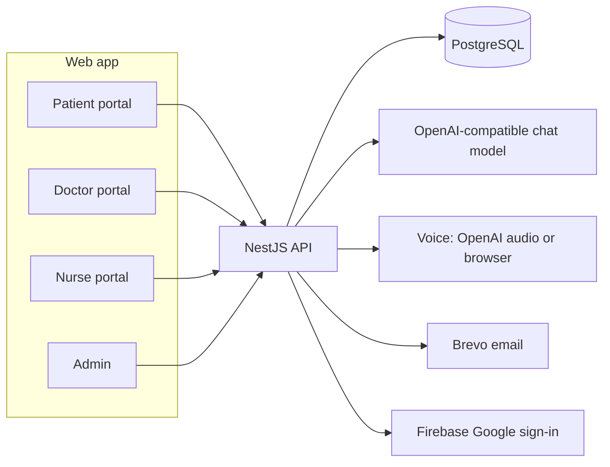

# Vita Care AI — AI Doctor & Specialist Booking

Patients in Pakistan describe symptoms in **Urdu, Roman Urdu, or English**. Vita Care AI asks the follow-up questions a doctor would, flags emergencies, recommends a verified specialist, and books the visit with that story attached.

**Live demo:** [https://vita-cares.vercel.app/](https://vita-cares.vercel.app/)

[](https://vita-cares.vercel.app/)
[](https://nextjs.org/)
[](https://nestjs.com/)
[](https://www.typescriptlang.org/)
[](https://www.postgresql.org/)
[](#author)

Built by **Syed Abdul Maarij** for the **Alibaba Cloud AI Hackathon Pakistan 2026**.

Vita Care AI gives preliminary guidance. It is not a diagnosis and has not been clinically validated. Emergencies are directed to **1122** or the nearest emergency department.

---

## Screenshots

These frames are placeholders. Drop live captures into `docs/screenshots/` using the same file names.

| Home | AI Doctor | Booking |
| --- | --- | --- |
|  |  |  |

| Patient portal | Doctor portal |
| --- | --- |
|  |  |

---

## Features

Verified in the app and API:

- **Three languages, typed or spoken.** Patients choose English, Urdu, or Roman Urdu, or leave detection on. Voice uses server transcription when a voice key is set, and the browser’s speech features otherwise.
- **A doctor-style interview.** The assistant asks one focused question at a time and offers short tap-to-answer options, then switches to an assessment.
- **Emergency flags that can only go up.** A rule list in all three languages runs on every message, independent of the model. A second model check may only raise urgency. The rules skip symptoms the patient denies or describes as already over. If the daily AI allowance is used up, an emergency still receives the rules-based emergency answer.
- **A specialist, then a booking.** The assessment names one department. Verified doctors in that department are listed with the patient’s city first. The booking page shows which slots are free, taken, or past, and a database constraint stops two patients from holding the same time.
- **The doctor sees the story first.** When the patient shares the session, the appointment stores the triage summary. The doctor portal opens chief complaint, history, urgency, and questions for the visit.
- **Separate patient and doctor portals.** Each dashboard checks the signed-in role and sends anyone else to their own home. The API repeats that check: patient routes and doctor routes do not accept the other role.
- **Licence before the public list.** New doctors (PMDC, or AHPC for physiotherapists) and nurses (PNC) stay pending until an admin verifies them. Only verified profiles can be viewed or booked.
- **Reports, home nursing, and an account.** A signed-in patient can photograph a lab report or prescription for a plain-language explanation. X-ray, CT, MRI, and ultrasound photos are described and referred to radiology. Doctors can order a home nurse; recorded vitals can raise an alert. The AI Doctor opens after email verification. Google sign-in is available when Firebase is configured.

Eleven departments are in the product: General Physician, Heart Care, Neurology, Pediatrics, Gynecology, Dermatology, ENT, Osteoporosis, Physiotherapy, Radiology, and Psychiatry.

---

## How a visit moves through the system



On each AI turn the API:

1. Runs the safety rules on the patient’s words.
2. Adds age, conditions, and medicines from the patient record. The prompt keeps the patient’s name and phone out.
3. Retrieves a short clinical guidance card for the complaint.
4. Asks the model to reason in English, reply in the patient’s language, and return one question or an assessment.
5. Runs a separate emergency check that can only raise urgency.
6. Keeps the higher urgency, recommends a department and nearby verified doctors, and saves a summary the booking can attach.

With no model key, the AI Doctor stays available in a labelled offline mode. The safety rules still run.

---

## Portals

| Role | Where they work | What they can do |
| --- | --- | --- |
| Patient | `/profile/patient` | AI Doctor, report explainer, book a doctor, request home nursing, see appointments and history |
| Doctor | `/profile/doctor` | Today’s visits, the AI pre-visit summary, complete or cancel a visit, order home nursing |
| Nurse | `/profile/nurse` | Accept home visits in their city after PNC verification, record vitals |
| Admin | `/admin` | Verify doctors and nurses, review AI safety, manage users, blog, and the audit log |

Booking, the AI Doctor, report reading, and home-nursing requests are patient tools. A signed-in doctor or nurse who opens them is sent back to their own dashboard. The clinical-notes API and the doctor appointment list require a doctor session.

Full access matrix: [`docs/RBAC.md`](docs/RBAC.md).

---

## Tech stack

| Layer | Choice |
| --- | --- |
| Web app | Next.js 14, React 18, TypeScript |
| API | NestJS 10, TypeORM, class-validator |
| Database | PostgreSQL (Docker image 16 for local development) |
| Auth | JWT, email verification, optional Google sign-in via Firebase |
| AI | Any OpenAI-compatible chat API. The hackathon setup targets Alibaba Cloud Qwen; OpenAI works on the same client |
| Voice | OpenAI audio when a voice key is set; browser speech as the fallback |
| Email | Brevo |
| Hosting | Next.js on Vercel, API and Postgres alongside it. See [`DEPLOYMENT.md`](DEPLOYMENT.md) |

---

## Local setup

**Requirements:** Node.js 18 or newer (20 or 22 recommended) and PostgreSQL 14 or newer, or Docker.

### 1. Database

```bash
createdb vita_care
# or:  docker compose up -d db
```

### 2. Backend (API on http://localhost:4000/api)

```bash
cd backend
cp .env.example .env          # fill in the names listed below
npm install
npm run migration:run         # creates the tables
npm run seed                  # fictional demo doctors, nurses, admin, patient, and blog posts
npm run start:dev
```

### 3. Frontend (site on http://localhost:3000)

```bash
cd frontend
cp .env.example .env.local
npm install
npm run dev
```

### 4. Turn on the AI and voice

In `backend/.env`, set the names in the table below. Comments in `backend/.env.example` show the public base URL and model name for OpenAI and for Alibaba Cloud Model Studio (Qwen).

One OpenAI-compatible key covers chat and lab-report reading. Urdu voice stays on the OpenAI audio API, including when chat uses Qwen, because that voice path is the one that supports Urdu here. Set `OPENAI_API_KEY` or `VOICE_API_KEY` for server voice. With no chat key, the AI Doctor runs in labelled offline mode.

Check `GET http://localhost:4000/api/chatbot/status` and `GET http://localhost:4000/api/voice/status`.

Daily allowances reset at midnight Pakistan time. Admins are unlimited. The code defaults are 40 messages, 5 report reads, and 40 voice turns; override them with `AI_DAILY_MESSAGES`, `AI_DAILY_REPORTS`, and `AI_DAILY_VOICE`.

Email verification and Google sign-in: [`docs/SETUP-EMAIL-GOOGLE.md`](docs/SETUP-EMAIL-GOOGLE.md).

### 5. Before a demo

```bash
cd backend && npm run demo:reset
```

This puts the pending doctor and nurse profiles back in the verification queue, restores today’s sample nurse visit, and removes throwaway test rows.

### Production

```bash
# backend
npm run build && npm run start:prod

# frontend
npm run build && npm start
```

Set a long random `JWT_SECRET`. The API refuses to start in production without one. Hosting steps are in [`DEPLOYMENT.md`](DEPLOYMENT.md).

### Demo accounts

Local seed only. Password for every account below: `Password123`. People, licence numbers, and phone numbers in the seed are fictional.

| Role | Email | What to open |
| --- | --- | --- |
| Patient | `patient@vitacare.test` | Ali Hassan, Karachi. AI history, bookings, home-visit vitals |
| Doctor | `dr.saif@vitacare.test` | Neurology. Open Ali’s visit: AI summary, history, vitals, order a nurse |
| Nurse | `nurse@vitacare.test` | Nasreen Akhtar, Karachi. Open requests and a visit ready for vitals |
| Admin | `admin@vitacare.test` | Pending doctors and a pending nurse to verify |

Other seeded doctors use addresses such as `dr.ayesha@vitacare.test`. Extra nurses use `nurse.1@vitacare.test` through later numbers in the seed.

---

## Environment variables

Names only. Copy the example files and set values locally or in the host. Do not commit `.env` or `.env.local`.

### Backend (`backend/.env`)

| Name | Used for |
| --- | --- |
| `PORT` | API port |
| `NODE_ENV` | Runtime mode |
| `CORS_ORIGIN` | Allowed frontend origins |
| `TRUST_PROXY` | Proxy hops for client IP and rate limits |
| `DATABASE_URL` | Hosted Postgres connection string. When set, the `DB_*` parts below are ignored |
| `DB_HOST` `DB_PORT` `DB_USERNAME` `DB_PASSWORD` `DB_NAME` | Local Postgres |
| `DB_SSL` `DB_SYNCHRONIZE` `DB_LOGGING` | SSL, schema sync (leave sync off), query logs |
| `JWT_SECRET` `JWT_EXPIRES_IN` `JWT_ADMIN_EXPIRES_IN` | Session signing and lifetime |
| `AI_API_KEY` `AI_BASE_URL` `AI_MODEL` `AI_VISION_MODEL` | Chat and report vision |
| `OPENAI_API_KEY` `VOICE_API_KEY` `VOICE_BASE_URL` | Server speech |
| `VOICE_STT_MODEL` `VOICE_TTS_MODEL` `VOICE_TTS_VOICE` | Transcription and spoken replies |
| `AI_DAILY_MESSAGES` `AI_DAILY_REPORTS` `AI_DAILY_VOICE` | Per-user daily AI allowance |
| `UPLOAD_DIR` | Doctor photos and blog images |
| `BREVO_API_KEY` `EMAIL_FROM_ADDRESS` `EMAIL_FROM_NAME` `APP_URL` | Verification and password email |
| `FIREBASE_PROJECT_ID` | Google sign-in on the API |
| `SUPPORT_EMAIL` | Contact-form delivery |
| `THROTTLE_DISABLED` | Test-only rate-limit switch |
| `EVAL_EMAIL` `EVAL_PASSWORD` | Optional login for the triage evaluation script |

### Frontend (`frontend/.env.local`)

| Name | Used for |
| --- | --- |
| `NEXT_PUBLIC_API_URL` | Public API base, including `/api` |
| `NEXT_PUBLIC_SITE_URL` | Canonical and share links |
| `API_INTERNAL_URL` | Optional server-side API URL for rendered pages |
| `NEXT_PUBLIC_FIREBASE_API_KEY` | Google sign-in in the browser |
| `NEXT_PUBLIC_FIREBASE_AUTH_DOMAIN` | Firebase auth domain |
| `NEXT_PUBLIC_FIREBASE_PROJECT_ID` | Firebase project |
| `NEXT_PUBLIC_FIREBASE_APP_ID` | Firebase web app |

---

## Tests

```bash
cd backend
npm test            # safety rules, departments, medicines, vitals, schedule
npm run test:e2e    # API tests, including role checks and booking conflicts
npm run eval        # triage evaluation cases

cd ../frontend
npm run test:maestro
```

How to run each suite: [`docs/TESTING.md`](docs/TESTING.md).

---

## Roadmap

- Clinical review of the triage rules and department cards with licensed clinicians.
- Appointment reminders by SMS or WhatsApp.
- Online payment of the doctor’s published fee.
- A patient mobile app with the same interview, booking, and receipt.
- Urdu speech on the same provider as the chat model, so one key covers chat and voice.
- A public doctor onboarding flow beyond the seeded directory, still gated on licence verification.

---

## More in this repo

| File | What it is |
| --- | --- |
| [`docs/RBAC.md`](docs/RBAC.md) | Who can open which route |
| [`docs/TESTING.md`](docs/TESTING.md) | Unit, API, evaluation, and browser flows |
| [`docs/EVALUATION.md`](docs/EVALUATION.md) | How triage quality is measured |
| [`docs/SETUP-EMAIL-GOOGLE.md`](docs/SETUP-EMAIL-GOOGLE.md) | Brevo and Firebase setup |
| [`DEPLOYMENT.md`](DEPLOYMENT.md) | Neon, Render, and Vercel |
| [`docs/WORK-SUMMARY.md`](docs/WORK-SUMMARY.md) | Build notes and earlier test results |

---

## Author

**Syed Abdul Maarij**

- GitHub: [github.com/maarijwaseem2](https://github.com/maarijwaseem2)
- LinkedIn: [linkedin.com/in/maarijwaseem2](https://www.linkedin.com/in/maarijwaseem2)

Built for the Alibaba Cloud AI Hackathon Pakistan 2026.
