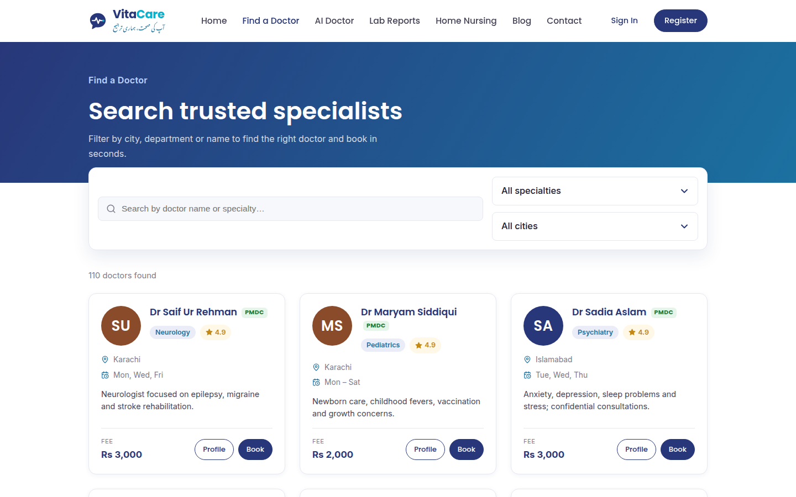
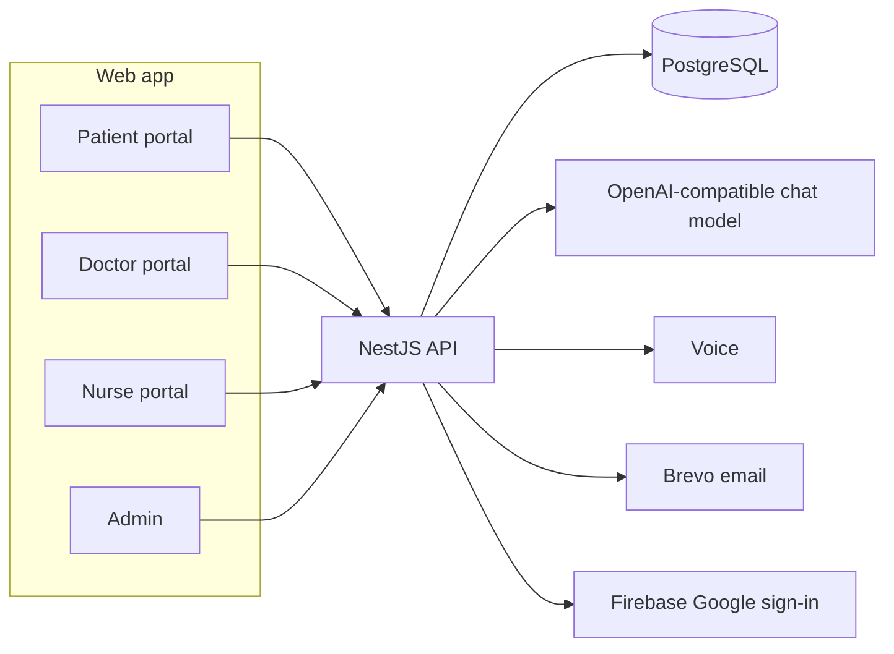

# Vita Care AI — AI Doctor & Specialist Booking

Patients in Pakistan describe symptoms in **Urdu, Roman Urdu, or English**. Vita Care AI asks the follow-up questions a doctor would, flags emergencies, recommends a verified specialist, and books the visit with that story attached.

**Live demo:** [https://vita-cares.vercel.app/](https://vita-cares.vercel.app/)

Built by **Syed Abdul Maarij** for the **Alibaba Cloud AI Hackathon Pakistan 2026**.

Vita Care AI gives preliminary guidance. It is not a diagnosis and has not been clinically validated. Emergencies are directed to **1122** or the nearest emergency department.

---

## Screenshots

Captured from the public site. The symptom interview itself opens after a free account, so the chat frame below is the public start of that flow.

| Home | Start a symptom check |
| --- | --- |
|  |  |

| Find a specialist | Book an open slot |
| --- | --- |
|  |  |

---

## Features

- **Three languages, typed or spoken.** Patients use English, Urdu, or Roman Urdu, or leave detection on. They can type or speak.
- **A doctor-style interview.** The assistant asks one focused question at a time, with short tap-to-answer options, then switches to an assessment.
- **Emergency flags that can only go up.** A rule list in all three languages runs on every message, separate from the model. A second check may only raise urgency. The rules skip symptoms the patient denies or describes as already over. An emergency still receives the rules-based emergency answer after the daily allowance is used.
- **A specialist, then a booking.** The assessment names one department. Verified doctors in that department appear with the patient’s city first. The booking page shows which slots are free, taken, or past, and two patients cannot hold the same time.
- **The doctor sees the story first.** When the patient shares the session, the appointment carries the triage summary: chief complaint, history, urgency, and questions for the visit.
- **Separate patient and doctor portals.** Patients use the AI Doctor, report explainer, booking, home nursing, and their history. Doctors see their visits, the pre-visit summary, and can complete a visit or order a home nurse. Nurses and admins have their own workspaces. Each portal stays with its own role.
- **Licence before the public list.** Doctors (PMDC, or AHPC for physiotherapists) and nurses (PNC) stay hidden until verified. Only verified profiles can be viewed or booked.
- **Reports and home nursing.** A patient can photograph a lab report or prescription for a plain-language explanation. X-ray, CT, MRI, and ultrasound photos are described and referred to radiology. A doctor can order a home nurse, and recorded vitals can raise an alert.

Eleven departments: General Physician, Heart Care, Neurology, Pediatrics, Gynecology, Dermatology, ENT, Osteoporosis, Physiotherapy, Radiology, and Psychiatry.

---

## Architecture

On each AI turn the service:

1. Runs the safety rules on the patient’s words.
2. Adds age, conditions, and medicines from the patient record. The prompt keeps the patient’s name and phone out.
3. Retrieves a short clinical guidance card for the complaint.
4. Asks the model to reason in English, reply in the patient’s language, and return one question or an assessment.
5. Runs a separate emergency check that can only raise urgency.
6. Keeps the higher urgency, recommends a department and nearby verified doctors, and saves a summary the booking can attach.

---

## Tech stack

| Layer | Choice |
| --- | --- |
| Web app | Next.js 14, React 18, TypeScript |
| API | NestJS 10, TypeORM |
| Database | PostgreSQL |
| Auth | JWT, email verification, Google sign-in |
| AI | Alibaba Cloud Qwen through an OpenAI-compatible chat API |
| Voice | Spoken questions and replies, with browser speech as the fallback |
| Email | Brevo |
| Live site | [vita-cares.vercel.app](https://vita-cares.vercel.app/) |

---

## Roadmap

- Clinical review of the triage rules and department cards with licensed clinicians.
- Appointment reminders by SMS or WhatsApp.
- Online payment of the doctor’s published fee.
- A patient mobile app with the same interview, booking, and receipt.
- Urdu speech on the same provider as the chat model.
- A wider public doctor directory, still checked against a professional licence.

---

## Author

**Syed Abdul Maarij**

- GitHub: [github.com/maarijwaseem2](https://github.com/maarijwaseem2)
- LinkedIn: [linkedin.com/in/maarijwaseem2](https://www.linkedin.com/in/maarijwaseem2)

Built for the Alibaba Cloud AI Hackathon Pakistan 2026.
